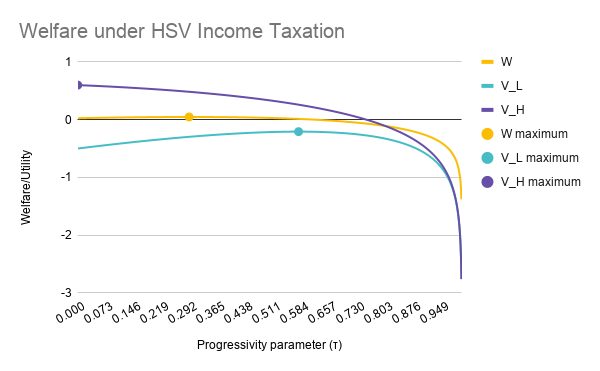

```{r, echo=FALSE}
knitr::opts_chunk$set(echo = FALSE, error=FALSE)
```

# Question 1: David

## Part A (Mirrlees)

### a. The planner solves:

$$ 
\max_{c_L,c_H,y_L,y_H}\ \tfrac12\Big[u(c_L)-v\big(\tfrac{y_L}{w_L}\big)\Big]+\tfrac12\Big[u(c_H)-v\big(\tfrac{y_H}{w_H}\big)\Big]\quad\text{s.t.}\quad \tfrac12 c_L+\tfrac12 c_H \le \tfrac12 y_L+\tfrac12 y_H .
$$

FOCS:

$$
\begin{aligned}
[c_l]:&\quad \tfrac12 u'(c_l)-\tfrac12\lambda=0 &&\rightarrow\quad u'(c_l)=\lambda \\
[y_l]:&\quad -\tfrac12\,\frac{v'(y_l/w_l)}{w_l}+\tfrac12\lambda=0 &&\rightarrow\quad \frac{v'(y_l/w_l)}{w_l} = \lambda \\
[c_h]:&\quad \tfrac12 u'(c_h)-\tfrac12\lambda=0 &&\rightarrow\quad u'(c_h)=\lambda \\
[y_h]:&\quad -\tfrac12\,\frac{v'(y_h/w_h)}{w_h}+\tfrac12\lambda=0 &&\rightarrow\quad \frac{v'(y_h/w_h)}{w_h} = \lambda \\
[\lambda]:&\quad y_l + y_h - c_l - c_h = 0
\end{aligned}
$$

Like in class, combining these FOCs gives MRS=MRT:

$$
\begin{aligned}
\lambda = \lambda \quad &\rightarrow \quad u'(c_L)=u'(c_H)\ \rightarrow\ c_L=c_H \quad (u''<0) \\
\lambda = \lambda \quad &\rightarrow \quad v'(n_H)=\lambda w_H>\lambda w_L=v'(n_L)\ \rightarrow\ n_H>n_L \quad (v''>0) \\
\text{MRS}=\text{MRT}: \quad &\frac{v'(n_i)}{u'(c_i)}=w_i
\end{aligned}
$$

Both types consume the same as per the first equation. High type has a higher wage given their higher productivity, and higher labor supply, thus their income is greater than the low-type. In this setting, the more productive type works more and earns more but consumes the same, so the high type is a net taxpayer and the low type a net recipient.

### b. 
If you're the high-type, and you're more productive, and yet consuming the same of the low-type, then the high-type would choose the low-type bundle. The low-type also stays as the high bundle is more hours, same consumption. This is a problem because if both agents pick $(c_L,y_L)$, then earnings fall, and the resource constraint is violated. The first best is not incentive compatible, which is why we need incentive constraints.

### c. 
I'll put the planners max. problem in a nicer format, as the $1/2$ eventually goes away. 

$$
\begin{aligned}
\max_{c_L,c_H,y_L,y_H}\ & \Big[u(c_L)-v\big(\tfrac{y_L}{w_L}\big)\Big]+\Big[u(c_H)-v\big(\tfrac{y_H}{w_H}\big)\Big]\\
\text{s.t.}\ & c_L+c_H= y_L+y_H \\
& v_H(c_H, y_H)\ = \ v_H(c_L,y_L) &&\text{(IC}_H), \\
& v_L(c_L, y_L)\ > \ v_L(c_H,y_H) &&\text{(IC}_L)
\end{aligned}
$$

The high-type IC says the high-type must prefer their bundle to mimicking the low-type. The low-type IC says the same for the low-type. The ICs shrink the feasible set; the first best falls outside it, as in part b where the high-type would mimic.

At the separating optimum, the high-type IC binds, since the planner redistributes until the high-type is just indifferent to mimicking. The low-type IC is slack, since the low-type never wants the high-type's bundle (more hours at a lower wage). The resource constraint binds, since nothing is wasted.

### d. 
In class we've stated the following conclusion:

> 1. At an optimum, we can't take all resources from being productive. $V_H > V_L$. The planner can’t equalize utilities. Mimicking takes fewer hours, so that utility is always more than the low-type gets. From binding IC$_H$: $V_H=u(c_L)-v(\tfrac{y_L}{w_H})>V_L$.

> 2. At a planner efficient condition, we want the high-type to work as much as possible, so we don't disturb their labor supply. We don’t distort the high-type’s labor supply, $T'(y_H)=0$. The high-type works the efficient amount (MRS=MRT). Taxing $y_H$ at the margin wouldn’t stop mimicking, so it would only cost efficiency. This doesn’t mean the high-type pays no taxes as their average tax is still positive. From the $(c_H,y_H)$ FOCs: $\frac{v'(n_H)}{u'(c_H)}=w_H$.

> 3. We can have a marginal tax ($0<T'(y_L)<1$) to preserve incentives, so we can't make the low-type attractive so that the high-type does not end up mimicking the low-type. This relaxes the high-type IC and lets the planner redistribute more. From the IC$_H$ multiplier distorting $y_L$ down.

## Part B (Ramsey)

Same setup as Part A. With the linear schedule, $\theta=(\tau,B)$ and $T(y;\theta)=\tau y-B$, where $0\le\tau<1$ and $B\ge 0$.

### e. 
Given $\theta$ and $w_i$, type $i$ solves: $\max_{c_i,n_i}u(c_i)-v(n_i)\quad\text{s.t.}\quad c_i=w_in_i-T(w_in_i;\theta)$

Substituting in for $c_i$ and taking the FOC:

$$
\begin{aligned}
&\max_{n_i}\ u\big(w_in_i-T(w_in_i;\theta)\big)-v(n_i) \\
[n_i]:\quad &\big(1-T'(y_i;\theta)\big)\,w_i\,u'(c_i)=v'(n_i)\quad\rightarrow\quad \frac{v'(n_i)}{u'(c_i)}=\big(1-T'(y_i;\theta)\big)w_i \\
\text{linear:}\quad &(1-\tau)\,w_i\,u'\big((1-\tau)w_in_i+B\big)=v'(n_i)
\end{aligned}
$$

An extra hour now adds only $(1-T')w_i$ to consumption instead of $w_i$. The marginal tax rate puts a wedge between the MRS and the MRT ($w_i$), so with $T'>0$ the household works less than at the first best. $B$ does not change the reward to the marginal hour; it acts only through an income effect in $u'(c_i)$. With the linear schedule, both types face the same wedge $\tau$.

### f. 
Given $\theta$, a TDCE is an allocation $(c_i,n_i)_{i=H,L}$ and prices $(w_i)_{i=H,L}$ such that:

1. HH optimize: given $\theta$ and $w_i$, $(c_i,n_i)$ solves 

$$\max_{c_i,n_i}\ u(c_i)-v(n_i) \quad \text{s.t.} \quad  c_i=w_in_i-T(w_in_i;\theta)$$

2. Government budget balances: $\tfrac12T(y_L;\theta)+\tfrac12T(y_H;\theta)=0$. Linear: $B=\tau\bar y$, where $\bar y=\tfrac{y_L+y_H}{2}$.
3. Goods market clears: $\tfrac{c_L+c_H}{2}=\bar y$. (Walras' law).

### g. 
Dropping the $1/2$ as in Part A:

$$
\begin{aligned}
\max_{\theta,\,(c_i,n_i)_{i=L,H}}\ & \big[u(c_L)-v(n_L)\big]+\big[u(c_H)-v(n_H)\big] \\
\text{s.t.}\ & \big(1-T'(w_in_i;\theta)\big)\,w_i\,u'(c_i)=v'(n_i), && i=L,H \\
& c_i=w_in_i-T(w_in_i;\theta), && i=L,H \\
& \tfrac12T(y_L;\theta)+\tfrac12T(y_H;\theta)=0 \\
& \tfrac{c_L+c_H}{2}=\bar y \\
& 0\le\tau<1,\quad B\ge 0 &&\text{(linear case)}
\end{aligned}
$$

The constraints are exactly the TDCE conditions from (f), so the planner can only implement allocations that are a TDCE for some $\theta$ in the family. Incentive compatibility is automatic, since each type chooses $n_i$ itself, but the implementable set is smaller than in Mirrlees. With one flat rate, the planner cannot set $T'(y_H)=0$ and $T'(y_L)>0$ at the same time, so Ramsey welfare is at most Mirrlees welfare.

How would I solve the problem: 
I'd first fix $\theta$ and solve the TDCE for $n_i(\theta)$, $y_i(\theta)=w_in_i(\theta)$, and $c_i(\theta)=y_i(\theta)-T(y_i(\theta);\theta)$, using the government budget to pin down the transfer. Linear: $B(\tau)=\tau\bar y(\tau)$, so $c_i(\tau)=(1-\tau)w_in_i(\tau)+\tau\bar y(\tau)$.
Then, I'd substitute these equilibrium functions into welfare and choose $\theta$:

$$
\max_{\tau}\ W(\tau)=\sum_{i\in\{L,H\}}\Big[u\big(c_i(\tau)\big)-v\big(n_i(\tau)\big)\Big]\quad\rightarrow\quad W'(\tau^*)=0
$$


\newpage


# Q1: Arun

## Part A: Mirrlees Taxation

### a:


$$
\begin{aligned}
\max_{c_L,c_H,y_L,y_H}\quad
&\frac12\left[u(c_L)-v\left(\frac{y_L}{w_L}\right)\right]
+\frac12\left[u(c_H)-v\left(\frac{y_H}{w_H}\right)\right]\\
\text{s.t.}\quad
&\frac12(c_L+c_H)\leq\frac12(y_L+y_H).
\end{aligned}
$$

Because $u'>0$, the resource constraint binds at the optimum. Multiplying the objective and resource constraint by two cleans the problem up as well. Using this, the Lagrangian is:

$$
\begin{aligned}
\mathcal{L}
= {} & u(c_L) + u(c_H)
- v\left(\frac{y_L}{w_L}\right)
- v\left(\frac{y_H}{w_H}\right) + \lambda(y_L+y_H-c_L-c_H).
\end{aligned}
$$

FOCs:

$$
\begin{aligned}
\frac{\partial\mathcal{L}}{\partial c_L}
&=u'(c_L)-\lambda=0,\\
\frac{\partial\mathcal{L}}{\partial c_H}
&=u'(c_H)-\lambda=0,\\
\frac{\partial\mathcal{L}}{\partial y_L}
&=-\frac{1}{w_L}v'\left(\frac{y_L}{w_L}\right)+\lambda=0,\\
\frac{\partial\mathcal{L}}{\partial y_H}
&=-\frac{1}{w_H}v'\left(\frac{y_H}{w_H}\right)+\lambda=0,\\
\frac{\partial\mathcal{L}}{\partial\lambda}
&=y_L+y_H-c_L-c_H=0.
\end{aligned}
$$

Combining the consumption FOCs gives:

$$
u'(c_L)=u'(c_H)=\lambda.
$$

Since $u''<0$, marginal utility is decreasing in consumption:

$$
c_L=c_H=\bar{c}.
$$

Combining the earnings FOCs gives:

$$
\frac{v'(y_L/w_L)}{w_L}
=
\frac{v'(y_H/w_H)}{w_H}
=\lambda.
$$

Since $n_i=y_i/w_i$, we can rewrite as:

$$
v'(n_L)=\lambda w_L,
\qquad
v'(n_H)=\lambda w_H.
$$

Since $w_H>w_L$ and $\lambda>0$,

$$
v'(n_H)>v'(n_L).
$$

Because $v''>0$, marginal disutility of labor is strictly increasing, so $n_H>n_L$. Because the high type has higher productivity and labor supply, their earning will also be greater:

$$
y_H=w_Hn_H>w_Ln_L=y_L.
$$

We can combine the consumption and earnings FOCs to get:

$$
\begin{aligned}
\frac{v'(y_i/w_i)}{w_i}&=u'(c_i),\\
\frac{v'(n_i)}{u'(c_i)}&=w_i.
\end{aligned}
$$

Via this, we have that the marginal rate of substitution equals the marginal rate of transformation, so the first-best efficiency condition is satisfied.

Since $c_H=c_L=\bar{c}$, net taxes for each type are:

$$
t_i=y_i^*-\bar{c}.
$$

$$
\bar{c}=\frac{y_L^*+y_H^*}{2}.
$$

Since $y_H^*>y_L^*$, we have $y_L^*<\bar{c}<y_H^*$, implying $t_H>0$ and $t_L<0$. So, there is redistribution from the high-productivity to the low-productivity workers.

### b:

Since $c_H=c_L=\bar{c}$ and $y_H>y_L$, the low-productivity worker prefers the low-type bundle, since choosing the high-type bundle would require more labor without any additional consumption. The high-productivity worker would also prefer the low-type bundle, as they can have the same consumption with less labor.

### c:

$$
\begin{aligned}
\max_{c_L,c_H,y_L,y_H}\quad
&u(c_L)+u(c_H)
-v(y_L/w_L)-v(y_H/w_H)\\
\text{s.t.}\quad
&c_L+c_H=y_L+y_H,\\
&u(c_H)-v(y_H/w_H)
\geq u(c_L)-v(y_L/w_H), \quad \text{(IC-H)}\\
&u(c_L)-v(y_L/w_L)
\geq u(c_H)-v(y_H/w_L), \quad \text{(IC-L)}
\end{aligned}
$$


These conditions require the workers to prefer their intended bundles (the high-productivity worker prefers the IC-H, and vice versa). These constraints restrict the feasible allocations to those under which neither type wants the other's bundle. The planner cannot implement the first-best allocation because both types would choose the low-type bundle.

At the separating optimum, the IC-H binds because the planner redistributes until the high type is indifferent between bundles. IC-L is slack because the wages remain the same under the high-type bundle, so the low-productivity worker will not want to contribute more labor for no reward. The resource constraint also binds.

### d:

The three results are:

1. Tax levels implement the optimal allocation and redistribute. At the redistributive optimum, the high type pays net taxes and the low type receives a transfer. This follows from the budget constraint $c_i=y_i-T(y_i)$.

$$
T(y_i^*)=y_i^*-c_i^*.
$$

2. No distortion at the top. The high type faces a zero marginal income tax rate, so additional earnings are not taxed at the margin. This follows from the optimality conditions. Distorting the high-type labor does not relax the high-type incentive constraint.

$$
T'(y_H^*)=0.
$$

3. Positive marginal taxation at the bottom. This happens because the high-type incentive constraint binds. Reducing the low type's earnings makes the bundle less attractive to high-productivity workers who might take the low type. This allows for more redistribution.

$$
0<T'(y_L^*)<1.
$$

## Part B: Ramsey taxation

### e: 

$$
\begin{aligned}
\max_{c_i,n_i}\quad
&u(c_i)-v(n_i)\\
\text{s.t.}\quad
&c_i=w_i n_i-T(w_i n_i;\theta).
\end{aligned}
$$

Substituting the budget constraint into utility and taking the FOC for $n_i$ gives:

$$
u'(c_i)w_i[1-T_y(y_i;\theta)]-v'(n_i)=0.
$$

$$
\frac{v'(n_i)}{u'(c_i)}
=w_i[1-T_y(y_i;\theta)].
$$

When we take $\theta=(t,B)$ and $T(y;\theta)=ty-B$, the household problem becomes:

$$
\begin{aligned}
\max_{c_i,n_i}\quad
&u(c_i)-v(n_i)\\
\text{s.t.}\quad
&c_i=(1-t)w_i n_i+B.
\end{aligned}
$$

The FOC under the linear schedule simplifies to:

$$
\frac{v'(n_i)}{u'(c_i)}=w_i(1-t).
$$

An additional hour of work will increase earnings by $w_i$, but increases after-tax consumption to $w_i(1-t)$.

So, a positive marginal tax rate will reduce the reward gotten from an additional hour of work, and create a wedge between the MRS and productivity. The first-best condition is not met unless the marginal tax rate is zero. The transfer $B$ does not directly change the marginal reward for labor.

## f:

For the tax schedule $T(y;\theta)$, a TDCE consists of allocations $(c_i,n_i,y_i)$ for each type $i\in\{L,H\}$, with $y_i=w_i n_i$, such that:

1. Households optimize. They do so according to:

$$
\begin{aligned}
\max_{c_i,n_i}\quad
&u(c_i)-v(n_i)\\
\text{s.t.}\quad
&c_i=w_i n_i-T(w_i n_i;\theta).
\end{aligned}
$$

2. The government budget balances. As the government does not make purchases, the aggregate net tax revenue must equal zero:

$$
\frac12T(y_L;\theta)+\frac12T(y_H;\theta)=0.
$$

3. The goods market clears. Aggregate consumption must equal aggregate production: 

$$
c_L+c_H=y_L+y_H.
$$

Given Walras' law, if the first two conditions are met, then the last market automatically clears.

## g:

$$
\begin{aligned}
\max_{\theta,c_L,c_H,n_L,n_H}\quad
&u(c_L)-v(n_L)+u(c_H)-v(n_H)\\
\text{s.t.}\quad
&c_L=w_Ln_L-T(w_Ln_L;\theta),\\
&c_H=w_Hn_H-T(w_Hn_H;\theta),\\
&u'(c_L)w_L[1-T_y(w_Ln_L;\theta)]=v'(n_L),\\
&u'(c_H)w_H[1-T_y(w_Hn_H;\theta)]=v'(n_H),\\
&\frac12 T(w_Ln_L;\theta)
+\frac12 T(w_Hn_H;\theta)=0,\\
&\frac12(c_L+c_H)
=\frac12(w_Ln_L+w_Hn_H).
\end{aligned}
$$

The constraints correspond to the definition of the TDCE in that they include the two household budget constraints, the two labor supply FOCs, the government budget balancing, and the goods market clearing.

This implies that the planner can only implement allocations under a tax schedule from the specified family. For example, the linear Ramsey problem imposes the same marginal rate on both the high and low types so it cannot implement the Mirrlees optimum.

The Ramsey problem can be solved by solving the TDCE for a given $\theta$ to determine the equilibrium levels for consumption $c_i(\theta)$, labor supply $n_i(\theta)$, and earnings $y_i(\theta)$, while balancing the government budget. Then, those equilibrium levels should be substituted into the welfare function, to choose the $\theta$ that maximizes social welfare.

\newpage

# Q1: Daniel
Part A:
a)
$$
\begin{gathered}
\max_{c_h, c_l, n_h, n_l} \frac{1}{2}(u(c_h)-v(n_h))+\frac{1}{2}(u(c_l)  -n(n_l)) \\
\text{Subject to:}\\
c_h +c_l= w_h n_h + w_ln_l\\
\text{Which yields FOCS:} \\
c_h: u'(c_h) -\lambda = 0 \\
c_l: u'(c_l) - \lambda = 0 \\
n_l: -v'(n_l) + \lambda w_l = 0 \\
n_h: -v'(n_h) + \lambda w_h = 0 \\
\end{gathered}
$$
It follows that the planner's first best solution occurs when $c_h = c_n$, and 
$$
\frac{w_h}{w_l} = \frac{v'(n_h)}{v'(n_l)} > 1
$$
which implies that the marginal dis-utility of labor is larger for the high type. It follows that the high type provides more labor than the low type at the first best solution, and thus has lower utility, given that consumption is equivalent. 

b)

Both types would choose $(c_L, y_L)$. Both types choose this bundle because both bundles have the same amount of consumption, but the low type bundle requires the worker to produce less, and thus enjoy more leisure. 

c)
Incentive compatibility means that the high type would prefer it's bundle over the low types bundle, and that the low type would prefer it's bundle over the high types bundle: 
$$
\begin{gathered}
u(c_h) - v(y_h w_h^{-1}) - u(c_l)+v(y_l w_h^{-1})>0 \\
u(c_l) - v(y_l w_l^{-1}) - u(c_h)+v(y_h w_l^{-1})>0
\end{gathered}
$$
Adding the incentive compatibility constraints to the planners problem effectively restricts their information set by requiring that at the bundle they choose for the household would also be the bundle the household would choose if offered both bundles. The low types incentive compatibility condition is slack because producing at the high type bundle would require an extremely high allocation of labor, which would have a very large dis-utility given that the dis-utility of labor function is convex. The high types incentive compatibility constraint holds with equality because to satisfy the high types compatibility constraint $y_l < y_h$, which implies that the marginal utility of income is higher for the low type, so transfers to the low type household are welfare improving up until the high type compatibility constraint binds. These constraints prevent the planner from implementing it's first best solution.
$$
\max_{c_h, c_l, y_h, y_l}  \frac{1}{2}(u(c_h)-v(y_h w_h ^{-1}))+\frac{1}{2}(u(c_l)  -n(y_lw_l^{-1})) \\
\text{Subject to:}\\
c_h +c_l= w_h n_h + w_ln_l\\
u(c_h) - v(y_hw_h^{-1}) = u(c_l) - v(y_l w_h^{-1}) \\
u(c_l) - v(y_l w_l^{-1}) = u(c_h)-v(y_h w_l^{-1})
$$
d) 
The lectures three main results where that:

The high type must have more consumption than the low type, and that their utilities must be at least equal. This result comes from the fact that we don't want the high type to mimic the how type and provide less labor. 

The marginal tax rate on the high type must be zero. This comes from the fact that we want the high type to provide as much labor as possible without violating incentive compatibility. If the high type faced a positive marginal rate it would disincentive them from providing labor, and force us to offer them more consumption to dissuade mimicking. 

The marginal tax rate at the bottom of the distribution must be positive. This is to further disincentive mimicking by the high type.

Part B: 

e) 

$$
\max_{c_i, n_i} u(c_i)- v(n_i) \\
\text{Subject to:} \\
c_i = w_in_i-T(w_in_i;\theta)
$$
Which yields FOCs:
$$
c_i: u'(ci) -\lambda = 0 \\
n_i -v'(n_i) -\lambda w_i + T'(w_in_i;\theta) =0
$$
Which can be combined to obtain:
$$
T'(w_in_i;\theta) =u'(c_i)w_i+v'(n_i)
$$

The households internalizes the tax schedule when choosing it's optimal labor supply, so a higher income tax rate will make it so the marginal rate of transformation between labor supply and utility decreases faster, resulting in a lower labor supply, this is especially true if the marginal tax rate is positive!

 f) 
 A tax distorted competitive equilibrium is a set of prices and allocations such that markets clear, agents maximize subject the distortions created by the mode of taxation, and the government budget constraint balances. 
 

g)
$$
\begin{aligned}
\max_{\tau, B, c_l, c_h, n_l, n_h}\quad
&\frac{1}{2}[u(c_l)-v(n_l)]+ \frac{1}{2}[u(c_h)-v(n_h)] \\
\text{Subject to:}\quad
&c_l = w_ln_l -T(w_ln_l;\theta) \\
&c_h = w_hn_h - T(w_hn_h;\theta) \\
&w_h T'(w_hn_h) =u'(c_h)w_h+v'(n_h) \\
&w_l T'(w_ln_l) =u'(c_l)w_l+v'(n_l) \\
&B = \frac{1}{2}[T(w_ln_l;\theta)+T(w_hn_h;\theta)]
\end{aligned}
$$

By forcing the planner to respect the household optimality conditions we restrict the planner to tax schedules which can be financed given the behavioral distortions they cause. To solve this problem we first must write each constraint as a function of $\theta$, and then discretize a grid of possible values of $\theta$ and use a a graph of numerical solver to find which value of $\theta$ maximizes welfare. 
\newpage

# Q2 Linear Taxation

## Part A

Assume throughout that $\theta=(\tau,B)$ and $T(y)=\tau y-B$, where $0\le\tau<1$ and $B\ge0$. Average income is $\bar y=p_Ly_L+p_Hy_H$.

### a. Define the TDCE

Given $(\tau,B)$, a TDCE is an allocation $(c_i,n_i)_{i=H,L}$ and prices $(w_i)_{i=H,L}$ s.t.:

1. HH optimize: given $(\tau,B)$ and $w_i$, each HH solves

$$
\begin{aligned}
\max_{c_i,n_i}\ &\ln c_i-\frac{n_i^2}{2}\quad\text{s.t.}\quad c_i=(1-\tau)w_in_i+B
\end{aligned}
$$

2. Government budget balances: $p_LT(y_L)+p_HT(y_H)=0\ \rightarrow\ B=\tau\bar y=\tau\,(p_Lw_Ln_L+p_Hw_Hn_H)$.
3. Goods market clears: $p_Lc_L+p_Hc_H=\bar y$. (Walras' law).

### b. Solve the TDCE

From the HH problem in (a): $[n_i]:\ \frac{(1-\tau)w_i}{c_i}=n_i$.

Substituting this FOC into the budget constraint gives a quadratic in $c_i$:

$$
\begin{aligned}
c_i=\frac{(1-\tau)^2w_i^2}{c_i}+B\quad&\rightarrow\quad c_i^2-Bc_i-(1-\tau)^2w_i^2=0 \\
c_i=\frac{B+s_i}{2},\qquad n_i=\frac{s_i-B}{2(1-\tau)w_i},\qquad y_i&=w_in_i=\frac{s_i-B}{2(1-\tau)},\qquad s_i\equiv\sqrt{B^2+4(1-\tau)^2w_i^2}
\end{aligned}
$$

taking the positive root. Substituting $y_i$ into the government budget:

$$
B=\tau\sum_i p_i\frac{s_i-B}{2(1-\tau)}\quad\rightarrow\quad (2-\tau)\,B=\tau\,(p_Ls_L+p_Hs_H)
$$

Squaring twice gives a quadratic in $B^2$:

$$
\begin{aligned}
B(\tau)^2&=\frac{\tau^2(1-\tau)\Big[p_L^2w_L^2\big(2(1-\tau)+p_H\tau^2\big)+p_H^2w_H^2\big(2(1-\tau)+p_L\tau^2\big)+p_Lp_H(2-\tau)R\Big]}{2(1-p_L\tau)(1-p_H\tau)} \\
R&\equiv\sqrt{\tau^2\big(p_Lw_L^2+p_Hw_H^2\big)^2+4(1-\tau)w_L^2w_H^2}
\end{aligned}
$$

Substituting $B(\tau)$ into $s_i$ gives $c_i(\tau)$, $n_i(\tau)$, and $y_i(\tau)$ in closed form. Tax rates, holding $(\tau,B)$ fixed: $\text{ATR}(y)=\frac{T(y)}{y}=\tau-\frac{B}{y}, \quad \text{and} \quad \text{MTR}(y)=T'(y)=\tau$. The MTR is the same for both types. The ATR rises with $y$, and it is negative for low earners ($y<B/\tau$), who are net recipients.

### c. Full Ramsey problem

$$
\begin{aligned}
\max_{\tau,B,(c_i,n_i)_{i=L,H}}\ & p_L\alpha_L\Big[\ln c_L-\frac{n_L^2}{2}\Big]+p_H\alpha_H\Big[\ln c_H-\frac{n_H^2}{2}\Big] \\
\text{s.t.}\ & \frac{(1-\tau)w_i}{c_i}=n_i, && i=L,H \\
& c_i=(1-\tau)w_in_i+B, && i=L,H \\
& B=\tau\,(p_Lw_Ln_L+p_Hw_Hn_H) \\
& p_Lc_L+p_Hc_H=p_Lw_Ln_L+p_Hw_Hn_H \\
& 0\le\tau<1,\quad B\ge0
\end{aligned}
$$

### d. Reduce the Ramsey problem

For any $\tau$, the functions $c_i(\tau)$, $n_i(\tau)$, and $B(\tau)$ from (b) satisfy every constraint in (c). Substituting them in leaves one choice variable:

$$
\max_{\tau}\ W(\tau)=p_L\alpha_L\Big[\ln c_L(\tau)-\frac{n_L(\tau)^2}{2}\Big]+p_H\alpha_H\Big[\ln c_H(\tau)-\frac{n_H(\tau)^2}{2}\Big]
$$

- Population shares $p_i$ enter as population weights in $W$, and through the government budget $B=\tau\bar y$.
- Welfare weights $\alpha_i$ enter only the objective. They do not affect the TDCE.

## Part B

### e. Implement 50/50

> Why do the two types prefer different policies?

The high type is a net taxpayer, so any $t>0$ costs them more in taxes than they get back in $B$, and it distorts their hours. They prefer $t=0$. The low type is a net recipient, so a higher $t$ raises their transfer. They keep wanting more $t$ until the shrinking tax base (both types work less) makes $B$ grow too slowly to offset their own distortion, at $t=0.599$.

> Which welfare weights would lead the planner to choose each type’s preferred policy?

The planner would pick the low-type if all the weight on the low type, $(\alpha_L,\alpha_H)=(1,0)$. The high type's policy ($t=0$) is a corner. At $t=0$, $n_i=1$ and $c_i=w_i$, so a small tax helps $L$ three times as much as it hurts $H$. The planner stays at $t^*=0$ only if $\alpha_H\ge 3\alpha_L$, i.e. $\alpha_H\ge 3/4$.


```{r}
#| label: q2-setup
#| message: false
library(ggplot2)

# B solves the government budget
tdce_linear <- function(tau, wL, wH, pL, pH) {
  w   <- c(L = wL, H = wH)
  s   <- function(B, w) sqrt(B^2 + 4 * (1 - tau)^2 * w^2)
  gbc <- function(B) (2 - tau) * B - tau * (pL * s(B, wL) + pH * s(B, wH))
  B   <- if (tau == 0) 0 else uniroot(gbc, c(0, 100 * wH), tol = 1e-12)$root
  c_i <- (B + s(B, w)) / 2
  n_i <- (s(B, w) - B) / (2 * (1 - tau) * w)
  y_i <- w * n_i
  V_i <- log(c_i) - n_i^2 / 2
  data.frame(tau = tau, B = B,
             nL = n_i[["L"]], nH = n_i[["H"]],
             yL = y_i[["L"]], yH = y_i[["H"]],
             cL = c_i[["L"]], cH = c_i[["H"]],
             VL = V_i[["L"]], VH = V_i[["H"]],
             ybar = pL * y_i[["L"]] + pH * y_i[["H"]])
}

# Solve the TDCE on a grid of tau
solve_grid <- function(wL, wH, pL, pH, aL, aH, grid = seq(0, 0.99, by = 0.001)) {
  out   <- do.call(rbind, lapply(grid, tdce_linear, wL = wL, wH = wH, pL = pL, pH = pH))
  out$W <- pL * aL * out$VL + pH * aH * out$VH
  out
}

argmax <- function(df, col) df[which.max(df[[col]]), ]
```

```{r}
#| label: q2-benchmark
#| results: asis
bench <- solve_grid(wL = 1, wH = 3, pL = 0.5, pH = 0.5, aL = 0.5, aH = 0.5)

objs  <- c(W = "W", V_L = "VL", V_H = "VH")
tab_e <- data.frame(
  Objective = names(objs),
  t = sapply(objs, function(v) argmax(bench, v)$tau),
  B = sapply(objs, function(v) argmax(bench, v)$B)
)

# Optimal policy and allocation, saved for the Question 5 comparison table
q2_opt <- transform(argmax(bench, "W"),
                    ATR_L = tau - B / yL, ATR_H = tau - B / yH,
                    MTR_L = tau,          MTR_H = tau)

# tables
tab_left <- knitr::kable(
  data.frame(Objective = c("$W$", "$V_L$", "$V_H$"), t = tab_e$t, B = tab_e$B),
  format = "latex", booktabs = TRUE, escape = FALSE, digits = 3, row.names = FALSE,
  col.names = c("Obj. Max.", "$t$", "$B$"))

labs16 <- c("$t$", "$B$", "$n_L$", "$n_H$", "$y_L$", "$y_H$", "$c_L$", "$c_H$",
            "$V_L$", "$V_H$", "$\\bar y$", "$W$",
            "ATR$_L$", "ATR$_H$", "MTR$_L$", "MTR$_H$")
grid16 <- matrix(c(rbind(labs16, sprintf("%.3f", unlist(q2_opt)))),
                 nrow = 4, byrow = TRUE)
tab_right <- knitr::kable(grid16, format = "latex", booktabs = TRUE, escape = FALSE,
                          align = rep(c("l", "r"), 4),
                          col.names = rep(c("", "Value"), 4))

cat("\\begin{center}\\footnotesize",
    "\\begin{minipage}[t]{0.30\\linewidth}\\centering",
    "\\textbf{Maximizers}\\\\[2pt]", tab_left, "\\end{minipage}\\hfill",
    "\\begin{minipage}[t]{0.66\\linewidth}\\centering",
    "\\textbf{Benchmark optimum (max $W$)}\\\\[2pt]", tab_right, "\\end{minipage}",
    "\\end{center}", sep = "\n")
```

```{r, fig.height=2.5}
#| label: fig-q2-benchmark
#| fig-cap: "Welfare and type utilities against the flat rate $t$, 50/50 benchmark."
long <- rbind(
  data.frame(tau = bench$tau, value = bench$W,  curve = "W"),
  data.frame(tau = bench$tau, value = bench$VL, curve = "V_L"),
  data.frame(tau = bench$tau, value = bench$VH, curve = "V_H")
)
maxes <- do.call(rbind, lapply(split(long, long$curve),
                               function(d) d[which.max(d$value), ]))

ggplot(long, aes(tau, value, colour = curve)) +
  geom_line() +
  geom_point(data = maxes) +
  geom_text(data = maxes, aes(label = sprintf("%s max: t = %.3f", curve, tau)),
            vjust = 1.7, hjust = 0, size = 3, show.legend = FALSE) +
  scale_color_viridis_d(option = "D") +
  labs(x = "t", y = "Welfare / utility", colour = NULL) +
  theme_minimal()
```

## Part C

```{r}
#| label: q2-opt-case
# Optimal t for one economy
opt_case <- function(wL, wH, pL, pH, aL, aH) {
  r <- argmax(solve_grid(wL, wH, pL, pH, aL, aH), "W")
  data.frame(t = r$tau, B = r$B, ybar = r$ybar, W = r$W)
}
```

```{r}
#| label: q2-fg
cases_fg <- data.frame(
  Case = c("Benchmark", "(f) Welfare weights", "(g) Population"),
  pL = c(1/2, 1/2, 2/3), pH = c(1/2, 1/2, 1/3),
  aL = c(1/2, 2/3, 1/2), aH = c(1/2, 1/3, 1/2)
)
res_fg <- cbind(Case = cases_fg$Case,
                do.call(rbind, Map(opt_case, 1, 3, cases_fg$pL, cases_fg$pH,
                                   cases_fg$aL, cases_fg$aH)))
knitr::kable(res_fg, digits = 3, row.names = FALSE,
             col.names = c("Case", "$t^*$", "$B^*$", "$\\bar y^*$", "$W^*$"))
```

### f. Change the planner's preferences

$t^*$ rises from 0.333 to 0.454, and $B^*$ from 0.547 to 0.680. The planner now cares more about the low type, who is the net recipient, so it accepts more distortion (hours fall and $\bar y^*$ drops from 1.644 to 1.498) in exchange for a bigger transfer.

### g. Change the population

$t^*$ is roughly unchanged (0.329 vs 0.333), but $B^*$ falls from 0.547 to 0.452 and $\bar y^*$ from 1.644 to 1.373. With fewer high types, the same rate raises less revenue per person.

### h. Same welfare objective, different populations

No. Both planners maximize the same obj. function, but $t^*=0.454$ in f and $0.329$ in part g. The difference comes from the government budget, $B=t\bar y=t\,(p_Ly_L+p_Hy_H)$. In f, half the population are high earners, so each point of $t$ funds a large $B$. In g, only a third are high earners, and the transfer goes to everyone, including the $2/3$ who are low types. So a higher $t$ mostly taxes low types' own earnings back to them. Redistribution costs more, so $t$ is lower; $p_i$ enters the budget, $\alpha_i$ doesn't.

### i. A higher wage for a smaller group

```{r}
#| label: q2-i
cases_i <- data.frame(
  Case = c("Benchmark", "95/5: wage only", "95/5: share only", "95/5: both",
           "99/1: wage only", "99/1: share only", "99/1: both"),
  wH = c(3, 5, 3, 5, 20, 3, 20),
  pL = c(0.50, 0.50, 0.95, 0.95, 0.50, 0.99, 0.99)
)
cases_i$pH <- 1 - cases_i$pL
res_i <- cbind(cases_i,
               do.call(rbind, Map(opt_case, 1, cases_i$wH, cases_i$pL, cases_i$pH,
                                  1/2, 1/2)))
knitr::kable(res_i, digits = 3, row.names = FALSE,
             col.names = c("Case", "$w_H$", "$p_L$", "$p_H$",
                           "$t^*$", "$B^*$", "$\\bar y^*$", "$W^*$"))
```

> For each split, explain the wage-only and share-only results relative to the benchmark.

- Wage only: $t^*$ rises (0.461 for 95/5, 0.553 for 99/1). The wage gap is wider and half the population is now very productive, more taxes implies bigger $B$. Planner taxes more.
- Share only: $t^*$ falls (0.110 for 95/5, 0.026 for 99/1). There are few high types to tax, so a higher $t$ mostly taxes the low types and hands it back to them. Planner taxes less.

> Use the wage-only and share-only optimal outcomes to explain the combined result.

Both: $t^*=0.228$ (95/5) and $0.264$ (99/1), between the two single changes. The share effect pulls $t^*$ down, since the rich are too few to fund much. The wage effect pulls it back up, since those few earn a lot (at 99/1, $y_H^*\approx 20$, so 1% of people still make up about a fifth of $\bar y$). The combined $t^*$ is still below the benchmark, so the share effect dominates.

> Which change has the larger effect on $t^*$?

The share change. Relative to the benchmark, it lowers $t^*$ by 0.22 (95/5) and 0.31 (99/1), while the wage change raises it by 0.13 and 0.22. What matters for the planner is how much revenue the high type provides, $p_Hy_H$.


# Q3 (Arun)

### a:

For the HSV tax schedule $T(y)=y-\lambda y^{1-\tau}$, a TDCE consists of allocations $(c_i,n_i,y_i)$ for each type $i\in\{L,H\}$, with $y_i=w_i n_i$, such that:

1. Households optimize. They do so according to:

$$
\begin{aligned}
\max_{c_i,n_i}\quad
&\ln(c_i)-\frac{n_i^2}{2}\\
\text{s.t.}\quad
&c_i=\lambda(w_i n_i)^{1-\tau}.
\end{aligned}
$$

2. The government budget balances. As the government does not make purchases, the aggregate net tax revenue must equal zero:

$$
p_L[y_L-\lambda y_L^{1-\tau}]
+p_H[y_H-\lambda y_H^{1-\tau}]=0.
$$

3. The goods market clears. Aggregate consumption must equal aggregate production: 

$$
p_Lc_L+p_Hc_H=p_Ly_L+p_Hy_H.
$$

Again, if the first two conditions are met, then the third is also met via Walras' law.

### b:

$$
\begin{aligned}
\max_{c_i,n_i}\quad
&\ln(c_i)-\frac{n_i^2}{2}\\
\text{s.t.}\quad
&c_i=\lambda(w_i n_i)^{1-\tau}.
\end{aligned}
$$

Substituting the budget constraint into utility:

$$
\max_{n_i}\quad
\ln\left[\lambda(w_i n_i)^{1-\tau}\right]
-\frac{n_i^2}{2}.
$$

$$
\max_{n_i}\quad
\ln(\lambda)+(1-\tau)\ln(w_i)
+(1-\tau)\ln(n_i)-\frac{n_i^2}{2}.
$$

FOCs:

$$
\begin{aligned}
\frac{\partial V_L}{\partial n_L}
&=\frac{1-\tau}{n_L}-n_L=0,\\
\frac{\partial V_H}{\partial n_H}
&=\frac{1-\tau}{n_H}-n_H=0.
\end{aligned}
$$

Rearranging the conditions gives:

$$
n_L^2=n_H^2=1-\tau.
$$

$$
n_i(\tau)=\sqrt{1-\tau}.
$$

$$
y_i(\tau)=w_i\sqrt{1-\tau}.
$$

Substitute the tax function into the government budget constraint and rearrange:

$$
\lambda=
\frac{p_Ly_L+p_Hy_H}
{p_Ly_L^{1-\tau}+p_Hy_H^{1-\tau}}.
$$

Substitute the definition of $y_i$:

$$
\lambda(\tau)=
\frac{\sqrt{1-\tau}(p_Lw_L+p_Hw_H)}
{(1-\tau)^{(1-\tau)/2}
(p_Lw_L^{1-\tau}+p_Hw_H^{1-\tau})}.
$$

$$
\lambda(\tau)=
\frac{(p_Lw_L+p_Hw_H)(1-\tau)^{\tau/2}}
{p_Lw_L^{1-\tau}+p_Hw_H^{1-\tau}}.
$$

Take the condition for consumption, substitute $\lambda(\tau)$ and simplify:

$$
c_i(\tau)=
\frac{\sqrt{1-\tau}(p_Lw_L+p_Hw_H)w_i^{1-\tau}}
{p_Lw_L^{1-\tau}+p_Hw_H^{1-\tau}}.
$$

$$
\begin{aligned}
ATR(y)
&=\frac{T(y)}{y}\\
&=\frac{y-\lambda y^{1-\tau}}{y}\\
&=1-\lambda y^{-\tau}.
\end{aligned}
$$

$$
\begin{aligned}
MTR(y)
&=T'(y)\\
&=\frac{d}{dy}\left(y-\lambda y^{1-\tau}\right)\\
&=1-\lambda(1-\tau)y^{-\tau}.
\end{aligned}
$$

### c:

$$
\begin{aligned}
\max_{\tau,\lambda,\{c_i,n_i,y_i\}_{i\in\{L,H\}}}\quad
&p_L\alpha_L\left[\ln(c_L)-\frac{n_L^2}{2}\right]
+p_H\alpha_H\left[\ln(c_H)-\frac{n_H^2}{2}\right]\\
\text{s.t.}\quad
&c_i=\lambda(w_i n_i)^{1-\tau},\\
&\frac{1-\tau}{n_i}-n_i=0,\\
&y_i=w_i n_i,\\
&p_L[y_L-\lambda y_L^{1-\tau}]
+p_H[y_H-\lambda y_H^{1-\tau}]=0,\\
&p_Lc_L+p_Hc_H=p_Ly_L+p_Hy_H,\\
&\lambda>0,\quad 0\leq\tau<1.
\end{aligned}
$$

### d:

For a given $\tau$, the equilibrium functions $c_i(\tau)$, $n_i(\tau)$, $y_i(\tau)$, and $\lambda(\tau)$ derived in part b satisfy the TDCE constraints from part c. So, we can substitute these functions into social welfare:

$$
\begin{aligned}
\max_{0\leq\tau<1}\quad W(\tau)
={}&p_L\alpha_L\left[\ln(c_L(\tau))-\frac{n_L(\tau)^2}{2}\right] +p_H\alpha_H\left[\ln(c_H(\tau))-\frac{n_H(\tau)^2}{2}\right].
\end{aligned}
$$

The population shares $p_i$ enter both the welfare objective and the government budget constraint. The welfare weights $\alpha_i$ enter only the welfare objective.

### e:

{#fig-hsv-welfare width="85%" fig-align="center" fig-pos="H"}


\begin{table}[htbp]
\centering
\begin{tabular}{lcc}
\hline
Objective Maximized & $\tau$ & $\lambda$ \\
\hline
$W$   & 0.290 & 1.196355 \\
$V_L$ & 0.575 & 1.205243 \\
$V_H$ & 0.000 & 1.000000 \\
\hline
\end{tabular}
\end{table}

The two types prefer different policies because they have different benefits and costs from redistribution. For example, the low type would benefit more from a more progressive system, as that would increase its share of after-tax income more. However, this would also reduce labor supply, so the gains are limited and they prefer an intermediate parameter. As for the high type, they would pay more under a more progressive system overall and have a reduction in consumption and labor supply, so they prefer a parameter with no redistribution.

The planner would choose the low type's preferred policy if they assigned all welfare weight to the low type, and choose the high type's preferred policy they assigned all welfare weight to the high type.


\begin{center}
\begin{tabular}{lcccc}
Case & $\tau^*$ & $\lambda^*$ & $\bar{y}^*$ & $W^*$ \\
\hline
Benchmark & 0.290 & 1.196355 & 1.685230 & 0.046351 \\
(f) Welfare weights & 0.414 & 1.233294 & 1.531013 & -0.012653 \\
(g) Population & 0.292 & 1.138256 & 1.402379 & -0.043735 \\
\end{tabular}
\end{center}

### f:

answer

### g:

answer

### h:

answer

### i:

\begin{center}
\begin{tabular}{lccc|cccc}
& \multicolumn{3}{c|}{Inputs} & \multicolumn{4}{c}{At the optimum} \\
Case & $w_H$ & $p_L$ & $p_H$ & $\tau^*$ & $\lambda^*$ & $\bar{y}^*$ & $W^*$ \\
\hline
Benchmark & 3 & 0.50 & 0.50 & 0.290 & 1.196355 & 1.685230 & 0.046351 \\
\hline
95/5: wage only & 5 & 0.50 & 0.50 & 0.414 & 1.505498 & 2.296519 & 0.215550 \\
95/5: share only & 3 & 0.95 & 0.05 & 0.133 & 1.009264 & 1.024241 & -0.219261 \\
95/5: both & 5 & 0.95 & 0.05 & 0.245 & 1.036525 & 1.042689 & -0.193481 \\
\hline
99/1: wage only & 20 & 0.50 & 0.50 & 0.611 & 3.740891 & 6.548836 & 0.761926 \\
99/1: share only & 3 & 0.99 & 0.01 & 0.039 & 1.000459 & 0.999912 & -0.244299 \\
99/1: both & 20 & 0.99 & 0.01 & 0.290 & 1.054431 & 1.002712 & -0.201157 \\
\end{tabular}
\end{center}

answer

# Q4 (Daniel)

$$
i \in \{L,H\}\\
y_i = w_in_i \\
V_i = log c_i -n_i^2/2 \\
p_H + p_L = 1 \\
W = p_L \alpha_LV_L+ p_H\alpha_HV_H \\
c_L +c_H = p_Hw_Hn_H+p_Lw_Ln_L

$$
A: 
a) 
$$
\bar y=p_H y_H + p_L y_L \\
\text{using resource constraint...} \\
c_H = p_Hy_H+p_Ly_L-c_L

$$
b)
For the bundles to be incentive compatible is must be the case that $\Delta_L,\Delta_H>0$, because is means that the workers prefer their assigned bundle over the other bundle. Conditional on the fact a bundle passes both checks the planners welfare function is given by
$$
W = p_L\alpha_L(log(c_L)-\frac{n_L^2}{2})+p_H\alpha_H(log(c_H)-\frac{n_H^2}{2})
$$
c) 
Solving the workers budget constraint for $T(y_i)$ yields
$$
T(y_i) = c_i - y_i \\
$$
Dividing both sides by $y_i$ results in the average tax rate
$$
\frac{T(y_i)}{y_i} = \frac{c_i}{y_i} -1
$$
Using the household FOCs to solve for $T(y_i)$ we arrive at 
$$
T'(y_i) = w_iu'(c_i) +v'(n_i) \\ 
T'(y_i) = w_i \frac{1}{c_i} + \frac{y_i}{w_i}
$$
d) 
```{r}
w_l <- 1
w_h <- 3
y_l <- seq(0, 1.28*w_l, by = 0.016*w_l)
y_h <- seq(0, 2.5*w_h, by = 0.025*w_h)
c_l <- seq(0.006, 9.6, by = 0.006)

grid <- expand.grid(y_l, y_h, c_l)
```

# Q5 (together)

### a:

\begin{center}
\scriptsize
\begin{tabular}{llrrrrrrrrr}
\hline
Policy & Type & $n_i$ & $y_i$ & $c_i$ & $T_i$ & ATR & MTR & $V_i$ & $W$ & $g_i$ (\%) \\
\hline
No tax & $L$ & 1.0000 & 1.0000 & 1.0000 & 0 & 0\% & 0\% & -0.500000 & 0.024653 & 0.00 \\
       & $H$ & 1.0000 & 3.0000 & 3.0000 & 0 & 0\% & 0\% & 0.598612 & & 0.00 \\
\hline
Linear & $L$ & & & & & & & & & \\
       & $H$ & & & & & & & & & \\
\hline
HSV & $L$ & 0.8426 & 0.8426 & 1.0594 & -0.2168 & -25.73\% & 10.73\% & -0.297305 & 0.046351 & 22.47 \\
    & $H$ & 0.8426 & 2.5278 & 2.3111 & 0.2168 & 8.58\% & 35.09\% & 0.482710 & & -10.94 \\
\hline
Mirrlees & $L$ & & & & & & & & & \\
         & $H$ & & & & & & & & & \\
\hline
\end{tabular}
\end{center}


\begin{center}
\begin{tabular}{lcc}
Policy & $\bar{y}$ & Change from no tax (\%) \\
\hline
No tax & 2.000000 & 0.00 \\
Linear & & \\
HSV & 1.685230 & -15.74 \\
Mirrlees & & \\
\end{tabular}
\end{center}


